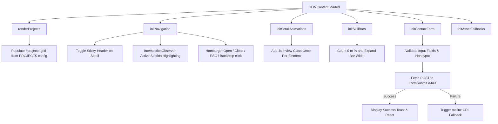
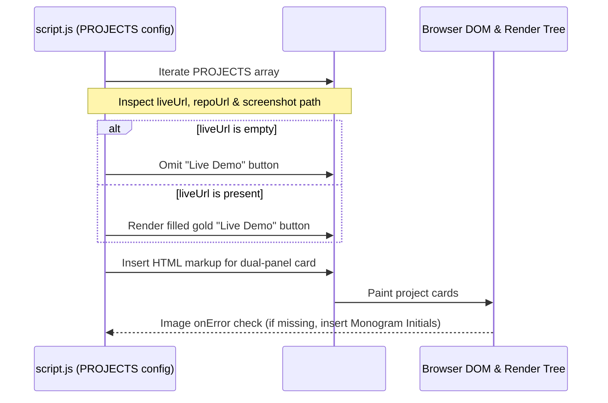
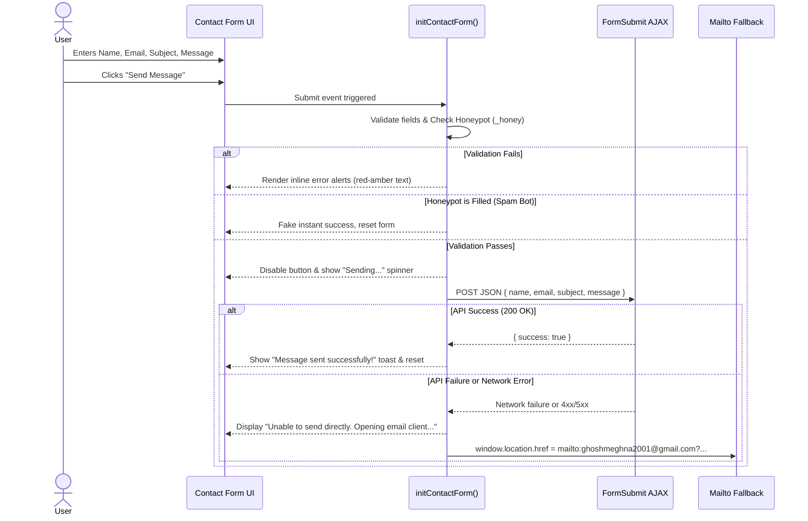

# 04 - Technical Architecture

This document describes the codebase directory structure, responsibilities of each file, CSS variable conventions, JavaScript module architecture, and complete data flows.

---

## 1. Directory & File Structure

```text
Meghna_Portfolio/
├── assets/
│   ├── Meghna_Ghosh_Resume.pdf      # Candidate resume (download target)
│   ├── profile.jpg                  # Candidate portrait photo
│   └── projects/                    # Project screenshot mockups
│       ├── autocare.png             # AutoCare Hub preview
│       ├── finance.png              # Finance Dashboard preview
│       └── calculator.png           # Calculator Website preview
├── docs/                            # Project documentation & specifications
│   ├── 01-project-overview.md
│   ├── 02-content-spec.md
│   ├── 03-design-system.md
│   ├── 04-architecture.md
│   ├── 05-animation-spec.md
│   ├── 06-responsive-plan.md
│   ├── 07-test-plan.md
│   ├── 08-task-breakdown.md
│   └── README.md
├── index.html                       # Semantic HTML5 single-page document
├── style.css                        # Design tokens, layouts, animations & responsive rules
└── script.js                        # Config, DOM rendering, observers, animations & handlers
```

---

## 2. File Responsibilities

### 2.1 `index.html`
- Serves as the single static entry point for the browser.
- Contains all HTML semantic landmarks:
  - `<header id="header">` containing `<nav>` and monogram branding.
  - `<main>` enclosing all page sections: `#home`, `#about`, `#experience`, `#education`, `#projects`, `#skills`, `#contact`.
  - `<footer>` enclosing social rows, copyright, and utility links.
- Defines standard `<head>` tags: UTF-8 encoding, responsive viewport, page title, SEO meta tags, Open Graph meta tags, favicon, and Google Fonts pre-connects.
- Includes a dedicated container `#projects-grid` where JavaScript dynamically mounts the project cards.
- Provides accessible fallbacks directly in markup (e.g. `noscript` messaging, image `alt` texts, and `aria` descriptions).

### 2.2 `style.css`
- Organised systematically using a modular structure:
  1. **Reset & Box Model**: Normalize margins, paddings, and `box-sizing: border-box`.
  2. **Design Tokens (`:root`)**: CSS Custom Properties for colors, typography, spacing, shadows, radii, and easings.
  3. **Base Typography**: Global body rules, heading defaults, link styles, and focus rings.
  4. **Shared Components & Utilities**: Buttons, badges, pills, section header rhythm, and container grids.
  5. **Section-Specific Layouts**: Scoped styling for Header, Landing, About, Experience, Education, Projects, Skills, Contact, and Footer.
  6. **Animation Keyframes**: Definitions for slide-ins, 3D flips, pulse glows, shimmers, and tosses.
  7. **Responsive Media Queries**: Breakpoints at `1024px`, `768px`, and `480px`.
  8. **Accessibility & Reduced Motion**: Overrides for `@media (prefers-reduced-motion: reduce)`.

### 2.3 `script.js`
- Written in clean vanilla JavaScript (ES6+), organized into clear functional modules:
  1. **`PROJECTS` Configuration**: Top-level array of project definitions.
  2. **Project Renderer**: Traverses `PROJECTS` and generates accessible DOM cards.
  3. **Navigation & Active Link Manager**: Manages sticky header styling, active section highlighting, and mobile drawer toggling.
  4. **Scroll Animation Observer**: Initializes `IntersectionObserver` to trigger one-time CSS animation classes on viewport entry.
  5. **Counter & Progress Bar Controller**: Triggers smooth counting and bar fills when the Skills section enters view.
  6. **Contact Form Controller**: Validates form inputs, prevents spam with honeypots, submits via `fetch` to FormSubmit AJAX, displays status feedback, and triggers a `mailto:` fallback if network fails.
  7. **Asset Fallback Handler**: Catches missing images and missing resume actions with user-friendly UI responses.

---

## 3. CSS Variable Naming Convention

All variables follow a strict kebab-case, taxonomy-based naming scheme defined under `:root`:

```css
:root {
  /* Colors - Backgrounds */
  --color-bg-primary: #0E0D0C;
  --color-bg-surface: #161412;
  --color-bg-surface-elevated: #201C18;
  
  /* Colors - Light Cards */
  --color-card-light: #FBF8F3;
  --color-card-light-muted: #F2EDE4;

  /* Colors - Text */
  --color-text-primary: #F3EDE4;
  --color-text-secondary: #A89F94;
  --color-text-dark: #161412;
  --color-text-dark-muted: #635B52;

  /* Colors - Accents */
  --color-accent-gold: #C8A15A;
  --color-accent-bronze: #A9713B;
  --color-accent-deep: #7A4E2A;
  --color-border-hairline: rgba(200, 161, 90, 0.2);
  --color-border-light: rgba(22, 20, 18, 0.12);

  /* Typography */
  --font-heading: 'Syne', sans-serif;
  --font-body: 'DM Sans', sans-serif;

  /* Spacing */
  --space-1: 4px;
  --space-2: 8px;
  --space-3: 12px;
  --space-4: 16px;
  --space-6: 24px;
  --space-8: 32px;
  --space-12: 48px;
  --space-16: 64px;
  --space-20: 80px;

  /* Radii */
  --radius-sm: 6px;
  --radius-md: 12px;
  --radius-lg: 18px;
  --radius-full: 9999px;

  /* Shadows */
  --shadow-subtle: 0 2px 8px rgba(0, 0, 0, 0.35);
  --shadow-card: 0 12px 32px -4px rgba(0, 0, 0, 0.45);
  --shadow-card-hover: 0 20px 40px -8px rgba(0, 0, 0, 0.65), 0 0 24px rgba(200, 161, 90, 0.18);
  --shadow-light-card: 0 16px 36px -6px rgba(0, 0, 0, 0.25);

  /* Animation Easing & Duration */
  --ease-smooth: cubic-bezier(0.16, 1, 0.3, 1);
  --ease-spring: cubic-bezier(0.34, 1.56, 0.64, 1);
  --duration-fast: 200ms;
  --duration-normal: 350ms;
  --duration-slow: 600ms;
  --duration-extended: 1000ms;
}
```

---

## 4. JavaScript Module & Function Layout



### Key Functions
- `renderProjects(config)`: Reads the `PROJECTS` array, generates cards with dark left panels and light right panels, handles missing screenshots gracefully, and suppresses "Live Demo" if `liveUrl` is empty.
- `initNavigation()`: Sets up the scroll spy with `IntersectionObserver`, marks active navigation links, and handles smooth scrolling with sticky header offset compensation.
- `initMobileMenu()`: Manages opening, closing, focus trapping, and `aria-expanded` state for the mobile hamburger drawer.
- `initScrollAnimations()`: Observes elements bearing `.animate-on-scroll`, adds `.is-inview` once, and unobserves to maximize performance.
- `animateSkills()`: Interpolates numerical values from 0 to target percent using `requestAnimationFrame`, synchronizing with CSS width transitions.
- `initContactForm()`: Binds blur and input validation to floating-label inputs, manages honeypot verification, sends asynchronous POST requests to FormSubmit, and executes the mailto fallback upon error.
- `initAssetFallbacks()`: Attaches error listeners to profile image and resume download actions to ensure friendly user messaging.

---

## 5. Data Flow Specifications

### 5.1 Project Configuration Data Flow


### 5.2 Contact Form Submission & Fallback Flow


