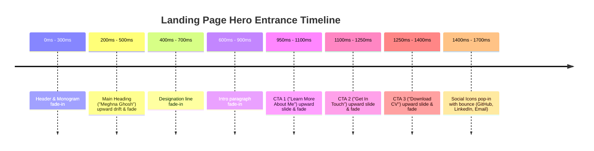

# 05 - Animation Specification

This document details every animation and micro-interaction across the portfolio, their timing, trigger criteria, implementation methods, and behavior when reduced motion is preferred.

---

## 1. Landing Page Animation Sequence

The landing hero section executes a planned orchestration upon initial page load:

---

## 2. Master Animation Matrix

| Section | Element | Trigger | Effect | Duration | Delay / Stagger | Easing | Implementation | `prefers-reduced-motion` |
|---|---|---|---|---|---|---|---|---|
| **Landing** | Headline & Intro | Page Load | Upward drift + fade in | `600ms` | Baseline `0ms - 600ms` | `var(--ease-smooth)` | CSS Keyframes | Instant display (opacity: 1) |
| **Landing** | 3 CTA Buttons | After text completes | Gentle upward slide + fade | `500ms` | Staggered: `950ms`, `1100ms`, `1250ms` | `var(--ease-smooth)` | CSS Keyframes | Instant display, no translate |
| **Landing** | Social Icons | After CTAs | Pop in with subtle elastic bounce | `400ms` | Staggered: `1400ms`, `1500ms`, `1600ms` | `var(--ease-spring)` | CSS Keyframes | Instant display, scale: 1 |
| **Landing** | "Download CV" CTA | Mouse Hover | Download icon nudges downward | `250ms` | `0ms` | `var(--ease-standard)` | CSS Transition (`translateY(4px)`) | No movement |
| **About** | Profile Photo | IntersectionObserver | Slide in from left with shadow bloom | `700ms` | `0ms` | `var(--ease-smooth)` | CSS class `.is-inview` | Instant display |
| **About** | 3 "View My Work" Buttons | After Photo | Slide up from below photo | `450ms` | Staggered `0.1s` apart | `var(--ease-smooth)` | CSS class `.is-inview` | Instant display |
| **About** | "View My Work" Buttons | Mouse Hover | Left-to-right underline draw + icon nudge | `250ms` | `0ms` | `var(--ease-standard)` | CSS pseudo-element `width: 100%` | Instant underline (no transition) |
| **About** | Mission Card | IntersectionObserver | 3D flip in (`rotateY(90deg)` to `0deg`) | `700ms` | `100ms` | `cubic-bezier(0.2, 0.8, 0.2, 1)` | CSS 3D Transform + perspective | Instant display (`rotateY: 0`) |
| **About** | Vision Card | IntersectionObserver | 3D flip in (`rotateY(90deg)` to `0deg`) | `700ms` | `300ms` (0.2s delay after Mission) | `cubic-bezier(0.2, 0.8, 0.2, 1)` | CSS 3D Transform + perspective | Instant display (`rotateY: 0`) |
| **Experience** | Alternating Cards | IntersectionObserver | Card 1 slides left->right, Card 2 slides right->left | `650ms` | Card 1: `0ms`, Card 2: `150ms` | `var(--ease-smooth)` | CSS class `.is-inview` | Instant display, `translateX(0)` |
| **Experience** | Dark Left Panel | On Card In-View | Curtain opening effect (width expands `0%` to `100%`) | `600ms` | `150ms` | `var(--ease-smooth)` | CSS pseudo/panel expansion | Instant full width |
| **Experience** | Bullets | After Panel expands | Stagger in top-to-bottom fade & slide | `400ms` | Staggered `0.15s` per bullet | `var(--ease-smooth)` | CSS keyframes with stagger delays | Instant display |
| **Experience** | Cards | Mouse Hover | Lift `translateY(-6px)` + deeper gold shadow | `300ms` | `0ms` | `var(--ease-standard)` | CSS Transition | No translate, subtle border tint only |
| **Experience** | Badge ("Independent" / "Open To Work") | Card Hover | Pulse glow effect | `800ms` | `0ms` | `ease-in-out` infinite alternate | CSS Keyframe (`box-shadow` pulse) | Static border color |
| **Education** | Card 1 (BCA) | IntersectionObserver | Drops in from above with slight rotation, lands flat | `750ms` | `0ms` | `var(--ease-spring)` | CSS Keyframe (`translateY(-40px) rotate(-3deg)` to `0`) | Instant display |
| **Education** | Card 2 (Languages) | IntersectionObserver | Rises from below simultaneously | `750ms` | `0ms` (simultaneous) | `var(--ease-spring)` | CSS Keyframe (`translateY(40px)` to `0`) | Instant display |
| **Education** | Highlight Bullets | After Card Lands | Left-to-right typewriter / mask wipe | `500ms` | Staggered `0.15s` per bullet | `var(--ease-smooth)` | CSS clip-path or width reveal | Instant display |
| **Education** | Card Hover | Mouse Hover | Golden/brown SVG border trace | `600ms` | `0ms` | `linear` | SVG `stroke-dasharray` / `stroke-dashoffset` | Static gold border |
| **Education** | Graduation Cap Icon | Card Hover | Small playful toss (`rotate` + `translateY`) | `400ms` | `0ms` | `var(--ease-spring)` | CSS Keyframe | No motion |
| **Projects** | Dark Left Panel | IntersectionObserver | Slide in from far left with blur-to-sharp transition | `650ms` | `0ms` | `var(--ease-smooth)` | CSS `filter: blur(8px)` to `0` + `translateX` | Instant display, blur: 0 |
| **Projects** | Right Content Panel | IntersectionObserver | Fade in `opacity: 0` to `1` | `500ms` | `300ms` delay | `var(--ease-smooth)` | CSS class `.is-inview` | Instant display |
| **Projects** | Outcome Boxes | After Content | Pop in one-by-one like dealt cards | `400ms` | Staggered `0.12s` each | `var(--ease-spring)` | CSS Keyframe (`scale(0.9)` to `1`) | Instant display |
| **Projects** | Tech Pills | After Outcomes | Rubber-band elastic bounce in | `500ms` | Staggered `0.08s` each | `var(--ease-spring)` | CSS Keyframe | Instant display |
| **Projects** | Screenshot Frame | Mouse Hover | Subtle zoom `scale(1.03)` inside frame | `350ms` | `0ms` | `var(--ease-standard)` | CSS Transition on `` | No scale |
| **Projects** | Project Card Hover | Mouse Hover | Warm brown glow, title letter-spacing expands | `300ms` | `0ms` | `var(--ease-standard)` | CSS Transition | Letter spacing static, subtle border |
| **Projects** | Action Buttons | Mouse Hover | External link / GitHub icon nudges | `200ms` | `0ms` | `var(--ease-standard)` | CSS Transition (`transform: translate`) | No translate |
| **Skills** | Category Cards | IntersectionObserver | Fade & scale `0.85` -> `1.0` in grid wave | `550ms` | Diagonal wave delay (`0.08s` * index) | `var(--ease-smooth)` | CSS class `.is-inview` | Instant display |
| **Skills** | Progress Bars | IntersectionObserver | Width animates from `0%` to target `%` | `1000ms` | Triggered on card in-view | `var(--ease-smooth)` | CSS transition on `width` | Final width immediately |
| **Skills** | Percent Number | IntersectionObserver | Counts up from `0` to target `%` in sync | `1000ms` | Synchronized with bar fill | Linear interpolation | JS `requestAnimationFrame` | Shows final number immediately |
| **Skills** | Category Icon | Card Hover | Slow 360-degree continuous or smooth spin | `700ms` | `0ms` | `var(--ease-smooth)` | CSS Transition (`transform: rotate(360deg)`) | No rotation |
| **Skills** | Category Card Hover | Mouse Hover | Lifted shadow with warm tint overlay | `300ms` | `0ms` | `var(--ease-standard)` | CSS Transition | Static shadow |
| **Contact** | Left Form Panel | IntersectionObserver | Slides in from bottom-left at slight angle, straightens | `700ms` | `0ms` | `var(--ease-smooth)` | CSS Keyframe (`translate(-20px, 40px) rotate(-2deg)`) | Instant display |
| **Contact** | Right Dark Panel | IntersectionObserver | Slides in from bottom-right simultaneously | `700ms` | `0ms` | `var(--ease-smooth)` | CSS Keyframe (`translate(20px, 40px)`) | Instant display |
| **Contact** | Field Underlines | After Form Lands | Underlines draw left-to-right sequentially | `350ms` per field | Name (0ms), Email (120ms), Subject (240ms), Message (360ms) | `var(--ease-smooth)` | CSS Transition on pseudo `width` | Instant border width |
| **Contact** | Send Button | Form Loaded | Single gentle pulse after render finishes | `600ms` | After field underlines finish | `ease-in-out` | CSS Keyframe pulse | No pulse |
| **Contact** | Send Button Hover | Mouse Hover | Diagonal shimmer sweep across surface | `500ms` | `0ms` | `ease-in-out` | CSS pseudo-element `linear-gradient` sweep | Solid background color |
| **Contact** | Contact Rows (Right) | Mouse Hover | Slide slightly right (`4px`), icon color shifts to gold | `250ms` | `0ms` | `var(--ease-standard)` | CSS Transition | Color shifts without translate |

---

## 3. IntersectionObserver Trigger Configuration

To ensure peak rendering performance and 60 FPS transitions:
1. **Observer Thresholds**:
   - Standard section elements: `threshold: 0.15` (triggers when 15% of element is visible).
   - Skills grid: `threshold: 0.2` (ensures category is clearly in view before bars count up).
2. **One-Time Execution (`once: true`)**:
   - Once an observed element receives its activation class (`.is-inview`), `observer.unobserve(element)` is called immediately. Elements never re-animate on reverse scrolling, eliminating jitter.
3. **Hardware Acceleration**:
   - Animated properties are constrained strictly to `transform` and `opacity` wherever possible.
   - Heavy elements use `will-change: transform, opacity` during active animation, automatically cleaned up when transitions settle.

